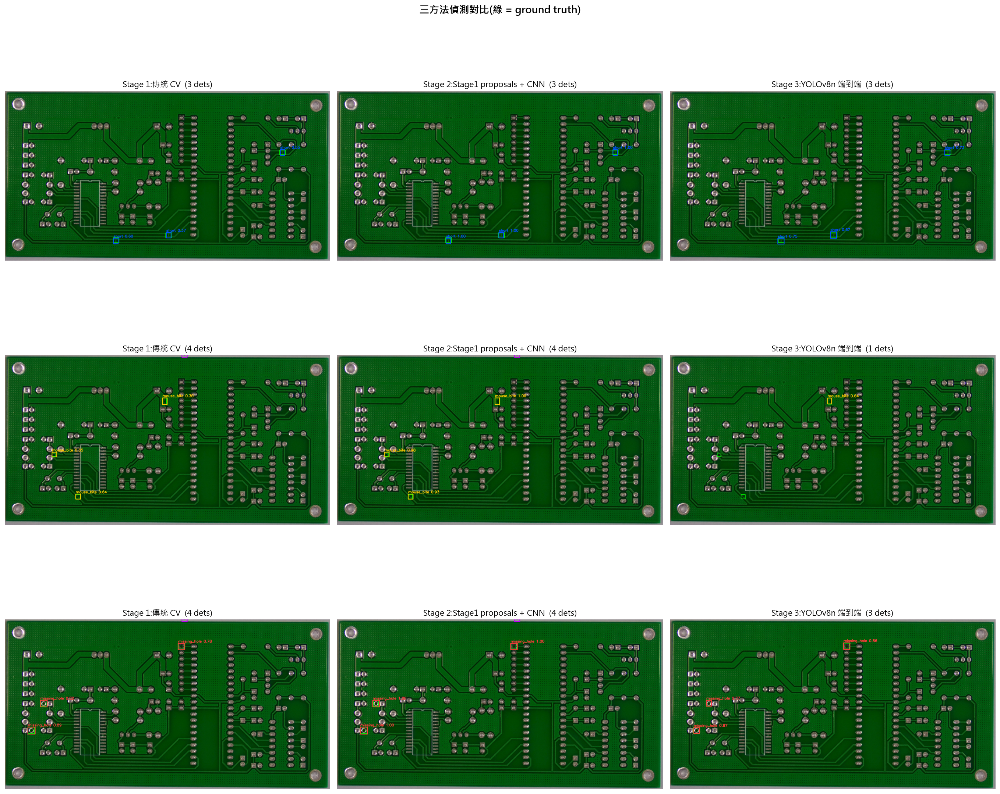
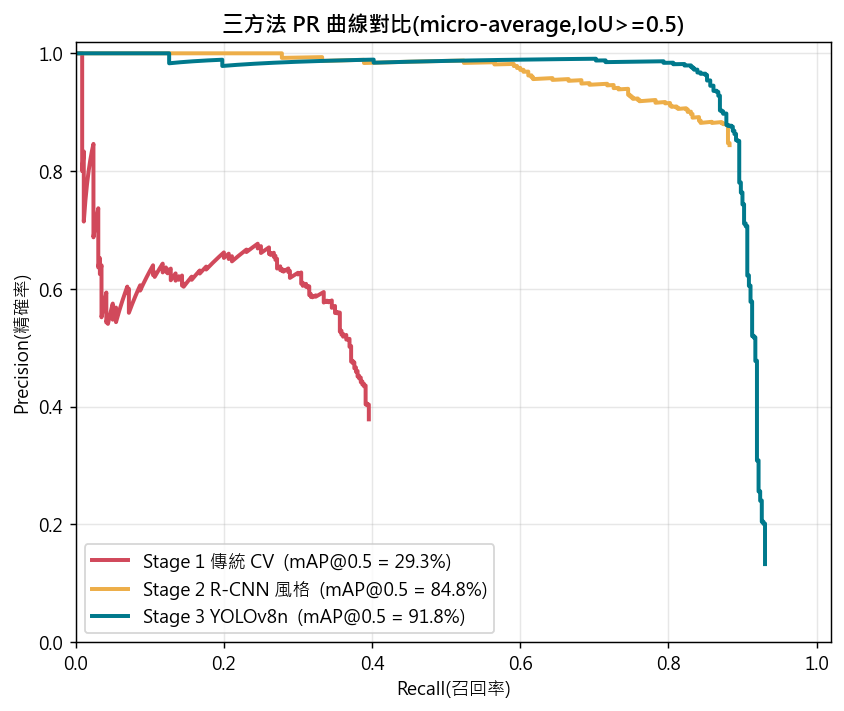
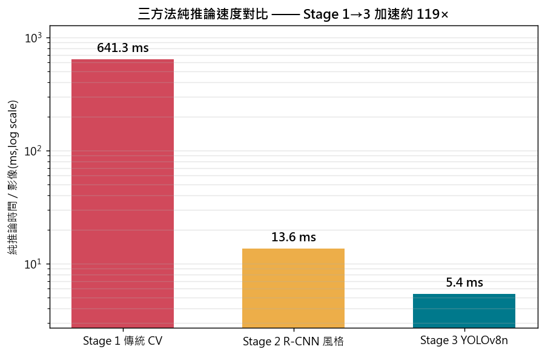

# PCB-AOI: Defect Detection on HRIPCB with Traditional CV, Two-stage DL, and End-to-end YOLO

PCB Automated Optical Inspection on the HRIPCB dataset, implemented three ways —
a classical computer-vision baseline, a two-stage (region-proposal + CNN)
detector, and an end-to-end YOLO detector — with a unified evaluation and an
interactive demo.

## Overview

This project implements and compares three approaches to printed-circuit-board
(PCB) surface-defect detection, evaluates them on a single fixed test split, and
wraps them in a Streamlit demo that mirrors the Recipe-based workflow of
production AOI systems. The three methods trace a clear bottleneck progression:
a classical pipeline that localises well but cannot classify fine-grained
defects, a CNN that fixes classification but is bounded by proposal recall, and
an end-to-end detector that removes the proposal dependency entirely.

## Methods

| Stage | Method | Description |
|---|---|---|
| 1 | Traditional CV | Template registration (ORB + homography) → colour difference → morphology → connected components → rule-based (nearest-prototype) classification. Needs a defect-free template. |
| 2 | Two-stage DL (R-CNN style) | Stage-1 region proposals cropped and classified by an ImageNet-pretrained ResNet18. |
| 3 | End-to-end YOLO | YOLOv8n trained to jointly localise and classify, no external proposals. |

## Dataset

**HRIPCB** (Open Lab on Human–Robot Interaction, Peking University). The base set
used here contains **693 images** across **6 defect classes** (`missing_hole`,
`mouse_bite`, `open_circuit`, `short`, `spur`, `spurious_copper`) with **2,953**
Pascal-VOC bounding boxes; the repository's pre-rotated augmentation set is
excluded (augmentation is done at train time instead). All three methods are
evaluated on the **same image-level test split** (`seed=42`, 108 images / 460
boxes).

- Reference / mirror: <https://github.com/Ironbrotherstyle/PCB-DATASET>
- Original paper: Huang & Wei, *A PCB Dataset for Defects Detection and
  Classification*, arXiv:1901.08204, 2019.

## Results

All numbers are on the fixed test split (`seed=42`):

| method | mAP@0.5 | mAP@0.5:0.95 | precision | recall | inference (ms) | model size (MB) | notes |
|---|---|---|---|---|---|---|---|
| Stage 1: Traditional CV | 0.293 | 0.141 | 0.288 | 0.391 | 641.3 | — | difference + morphology; hand-crafted features hit a classification ceiling |
| Stage 2: Two-stage DL (proposals + CNN) | 0.848 | 0.390 | 0.848 | 0.883 | 13.6 | 44.8 | ResNet18 forward (excl. Stage-1 proposal generation); bounded by proposal recall |
| Stage 3: End-to-end YOLO | 0.918 | 0.467 | 0.935 | 0.862 | 5.4 | 6.3 | end-to-end, no proposal dependency; breaks the `short` recall bottleneck |

From Stage 1 to Stage 3, **mAP@0.5 rises from 29.3% to 91.8%** while pure
inference time **accelerates ~119×** (641 ms → 5.4 ms). The single defect class
that the two-stage method could not recover, `short`, goes from AP 19.7% (Stage 1)
→ 36.2% (Stage 2) → **97.5%** (Stage 3), because the end-to-end detector no longer
depends on Stage-1 proposal recall.

Inference time is defined consistently as the model-forward step only (no image
I/O): for Stage 1 the classical pipeline compute, for Stage 2 the ResNet18 forward
(excluding Stage-1 proposal generation), for Stage 3 the ultralytics-reported
inference time.





The full comparison table is in
[`results/comparison_table.md`](results/comparison_table.md); per-stage reports
are in [`results/`](results/) and the walkthrough notebooks in
[`notebooks/`](notebooks/).

## 作業二專項實驗：Stage 2 ResNet18 訓練週期（Epochs = 5, 10, 15）敏感度與可重現性驗證

針對 **Stage 2（兩階段缺陷分類系統）** 進行深度超參數敏感度實驗，主題為：**「探討訓練輪數（Training Epochs）對 CNN 分類性能、收斂穩定性與測試集不良品召回率的影響」**。實驗鎖定訓練輪數為唯一自變數，評估其在工業外觀檢測（AOI）場景下的收斂極限與系統邊界效應。

### 1. 環境建置與執行說明（Execution Guide）

本專案全面支援現代化極速 Python 套件管理工具 **`uv`**（亦相容標準 `pip`）。以下為虛擬環境建置與 CLI 指令執行範例：

```bash
# 1. 使用 uv 建立 Python 3.11+ 虛擬環境並安裝依賴
uv venv
# Windows 啟用虛擬環境: .\.venv\Scripts\activate
# Linux/macOS 啟用: source .venv/bin/activate

# 2. 安裝核心依賴與 PyTorch (可依據本機 CUDA 版本對應安裝)
uv pip install -r requirements.txt

# 3. 執行擴充後的 CLI 實驗指令（以 Epochs = 5 為例）：
# (a) 訓練分類器：跑滿 5 輪（--no-early-stop），分別儲存 Best 與 Last 權重及日誌
python -m src.train_classifier --epochs 5 --no-early-stop \
    --weights models/defect_classifier_ep5_best.pt \
    --weights-last models/defect_classifier_ep5_last.pt \
    --log results/training_log_ep5.csv

# (b) 雙權重評估：同時評估 Last 與 Best 權重之 GT Crops 指標及端到端 mAP
python -m src.evaluate_classifier \
    --weights models/defect_classifier_ep5_best.pt \
    --weights-last models/defect_classifier_ep5_last.pt \
    --out results/classifier_eval_ep5.json

# (c) 視覺化圖表產出：生成訓練曲線、混淆矩陣、預測範例與誤判分析
python -m src.viz_classifier \
    --log results/training_log_ep5.csv \
    --weights models/defect_classifier_ep5_last.pt \
    --suffix _ep5

# 依此類推，Epochs = 10 與 15 只需替換 --epochs 10 / 15 與對應檔名後綴：
# python -m src.train_classifier --epochs 10 --no-early-stop --weights models/defect_classifier_ep10_best.pt --weights-last models/defect_classifier_ep10_last.pt --log results/training_log_ep10.csv
# python -m src.train_classifier --epochs 15 --no-early-stop --weights models/defect_classifier_ep15_best.pt --weights-last models/defect_classifier_ep15_last.pt --log results/training_log_ep15.csv
```

### 2. 實驗控制與可重現性設計（Reproducibility & Data Integrity）

為落實嚴謹的科學實驗對照原則，全實驗流程實施五大控制機制：

1. **嚴格單一自變數（Controlled Independent Variable）**：
   - 唯一自變數為 **`Training Epochs`（5, 10, 15 輪）**。
   - 其餘超參數全數凍結：學習率（`lr = 1e-4`）、優化器（`Adam`）、批次大小（`batch_size = 64`）、排程器（`ReduceLROnPlateau(factor=0.5, patience=4)`）、上下文外擴（`pad_ratio = 0.3`）以及輸入維度（`224×224`）。
2. **全局隨機種子完全固化（Deterministic Random Seeds）**：
   - 透過 `src.train_classifier.set_seed(42)` 固化 `random`、`numpy`、`torch.manual_seed`，並設定 `torch.backends.cudnn.deterministic = True` 與 `cudnn.benchmark = False`。
   - DataLoader 載入器綁定專屬隨機生成器（`torch.Generator().manual_seed(42)`），確保 Shuffle 資料抽樣順序完全決定性。
3. **影像級分層防洩漏切分（Image-level Stratified Splitting）**：
   - 完全沿用 `src.dataset.build_splits(seed=42)`，切分為 **70% 訓練集 (483 張 / 2,051 crops)**、**15% 驗證集 (102 張 / 442 crops)**、**15% 測試集 (108 張 / 460 crops)**。
   - 嚴格堅持以「影像為單位」進行缺陷分層切分，嚴防同張 PCB 上的多個瑕疵被割裂至不同 split 導致嚴重資料洩漏。
4. **零權重殘留與前 5 輪 Loss 完全重合驗證（Zero Weight Carry-Over）**：
   - 每組實驗皆從 ImageNet-1K 預訓練權重重新初始化，並在相同隨機種子下初始化最終分類層（`fc`），嚴禁接續前一組訓練權重。
   - **實證重現檢驗**：在完全相同的種子與資料流下，實驗組 A (5 輪)、組 B (10 輪)、組 C (15 輪) 與 Baseline 的**前 5 輪 Train Loss 與 Val Loss 數值完全精確重合（Epoch 1: 0.1661 / 0.1257，Epoch 2: 0.0526 / 0.0523...）**，驗證各實驗組具備 100% 可重現性與乾淨獨立性。
5. **測試集嚴禁洩漏調參（Strict Test Split Sequestration）**：
   - 驗證集僅供早停判定與學習率排程監控；測試集 460 筆 GT crops 僅在訓練徹底終止後作為量化評估的最終基準。

### 3. 實驗結果總表（Benchmark Summary）

在測試集（Test Split）460 個真實標籤瑕疵塊（GT Crops）下，各組最後一輪（`Last Epoch`）與最佳驗證輪（`Best Val Epoch`）之完整量化指標與 6 類不良品獨立召回率對照如下：

| 實驗組別設定 (`Training Epochs`) | Train Loss | Val Loss | Val Acc (%) | Macro Recall (%) | Micro Recall / Test Acc (%) | missing_hole Recall (%) | mouse_bite Recall (%) | open_circuit Recall (%) | short Recall (%) | spur Recall (%) | spurious_copper Recall (%) | End-to-End mAP@0.5 (%) |
|---|---|---|---|---|---|---|---|---|---|---|---|---|
| **實驗組 A** (`Epochs = 5`) | 0.0211<br>*(Best@Ep4: 0.0216)* | 0.0403<br>*(Best@Ep4: 0.0346)* | 99.32%<br>*(Best: 99.77%)* | 99.14%<br>*(Best: 99.78%)* | 99.13%<br>*(Best: 99.78%)* | 98.65%<br>*(Best: 100%)* | 100.00% | 100.00% | 100.00% | 97.40%<br>*(Best: 98.70%)* | 98.78%<br>*(Best: 100%)* | 84.93%<br>*(Best: 85.12%)* |
| **實驗組 B** (`Epochs = 10`) | 0.0330<br>*(Best@Ep8: 0.0068)* | 0.0330<br>*(Best@Ep8: 0.0279)* | 98.87%<br>*(Best: 99.55%)* | 99.37%<br>*(Best: 99.57%)* | 99.35%<br>*(Best: 99.57%)* | 98.65% | 100.00% | 100.00% | 100.00% | 100.00% | 97.56%<br>*(Best: 98.78%)* | 85.40%<br>*(Best: 85.79%)* |
| **實驗組 C** (`Epochs = 15`) | 0.0077<br>*(Best@Ep11: 0.0096)* | 0.0326<br>*(Best@Ep11: 0.0203)* | 99.32%<br>*(Best: 99.55%)* | 99.33%<br>*(Best: 99.56%)* | 99.35%<br>*(Best: 99.57%)* | 98.65% | 100.00%<br>*(Best: 98.70%)* | 98.61%<br>*(Best: 100%)* | 100.00% | 98.70%<br>*(Best: 100%)* | 100.00% | 84.47%<br>*(Best: 85.50%)* |
| **基準對照組** (`Baseline`, max=50, 實際 31 輪 EarlyStop) | 0.0052<br>*(Best@Ep21: 0.0047)* | 0.0169<br>*(Best@Ep21: 0.0111)* | 99.77% | **100.00%** | **100.00%** | 100.00% | 100.00% | 100.00% | 100.00% | 100.00% | 100.00% | 84.75% |

#### 骨幹網路凍結消融實驗結論（Ablation: `freeze_backbone=True`）
在固定 `Epochs = 10`、相同隨機種子下，進一步測試傳統特徵抽取策略（凍結 ResNet18 骨幹，僅訓練最後分類層）：
- **分類性能全面崩跌**：可訓練參數量由 1,118 萬驟降至 3,078 個（-99.97%），但測試集準確率從 **99.35% 暴跌至 50.65%**（誤判由 3 筆激增至 227 筆），宏平均召回率由 **99.37% 腰斬至 50.44%**。
- **微小拓撲瑕疵毀滅性漏檢**：雖然宏觀對稱缺陷 `missing_hole`（缺孔）仍維持 95.95% 召回率，但涉及線路拓撲連通性與細微邊緣結構的瑕疵遭受毀滅性衝擊——`short`（短路）召回率驟降至 **34.62%**、`open_circuit`（開路）驟降至 **22.22%**、`spur`（突刺）更直接暴跌至 **16.88%**（83% 嚴重漏檢）。
- **工業實務啟示**：在工業 PCB 瑕疵檢測中，自然影像（ImageNet）提取的宏觀幾何特徵無法直接對應電氣線路拓撲連通關係，**全網路微調（Full Fine-tuning）為不可或缺的絕對關鍵步驟**。

#### 系統架構瓶頸結論（End-to-End Proposal Bottleneck）
- 不論 CNN 分類器訓練 5 輪、10 輪、15 輪或 31 輪（其 GT Crop 準確率皆在 99.1% ~ 100% 之間），**全系統端到端 mAP@0.5 皆停滯在 84.5% ~ 85.8% 區間**。
- 原因在於兩階段架構受限於前端 Stage 1 傳統差影法對短路（`short`）候選框的低召回率（僅 ~43% AP），分類器即便具備 100% 辨識能力亦無從挽救漏框，此現象直接印證專案演進至 **Stage 3 端到端 YOLO** 的必要性。

## Streamlit Demo

An interactive demo lets you run all three methods on the same board and observe
their differences.

```bash
streamlit run app.py
# or:  ./run_aoi_app.bat   (Windows)
#      ./run_aoi_app.sh    (Linux/macOS)
```

Then open <http://localhost:8501>.

Behaviour differences between the methods in the demo:

- **Stage 1** requires selecting a **Recipe** (defect class → corresponding
  golden template) before inspection, then does template differencing.
- **Stage 2** takes a single image directly. Since the demo has no template, it
  uses an **MSER class-agnostic region proposal** in place of the
  difference-based proposal used elsewhere; precision/recall are therefore lower
  than the full template-based pipeline (this is labelled in the app).
- **Stage 3** takes a single image directly and runs end-to-end.

> The bundled demo images in [`samples/`](samples/) are resized to 1600 px on the
> long side to keep the repository small. The headline metrics in the Results
> section are computed on the full-resolution dataset; see
> `results/comparison_table.md`.

## Installation

Requires **Python 3.11+** and a CUDA-capable GPU for the deep-learning stages.

PyTorch is installed separately so it matches your CUDA version, and
`ultralytics` is installed with `--no-deps` so it cannot overwrite your torch
build. This project was developed on a CUDA 12.8 nightly
(`torch 2.12.0.dev+cu128`, RTX 5070 Ti / Blackwell).

```bash
# 1) install torch/torchvision for your CUDA — see https://pytorch.org
# 2) install ultralytics without its dependencies
pip install ultralytics==8.4.60 --no-deps
pip install py-cpuinfo scipy seaborn polars
# 3) install the remaining requirements
pip install -r requirements.txt
```

See the header of [`requirements.txt`](requirements.txt) for details.

### Getting the dataset

The pipeline code and the demo's bundled samples do not require the full dataset.
To reproduce training/evaluation, fetch the HRIPCB base set into `data/HRIPCB/`
(a sparse checkout avoids downloading the augmentation set):

```bash
cd data
git clone --filter=blob:none --no-checkout https://github.com/Ironbrotherstyle/PCB-DATASET.git HRIPCB
cd HRIPCB
git sparse-checkout init --cone
git sparse-checkout set images Annotations PCB_USED
git checkout master
rm -rf .git           # optional: reclaim the promisor pack
```

Then build the YOLO-format dataset with `python -m src.voc_to_yolo`.

## Project Structure

```
pcb-aoi/
├── app.py                      # Streamlit demo
├── run_aoi_app.bat / .sh       # demo launchers
├── src/
│   ├── hripcb.py               # dataset / VOC parsing utilities
│   ├── traditional_cv.py       # Stage 1 pipeline
│   ├── dataset.py              # crop dataset + image-level splits
│   ├── dl_classifier.py        # ResNet18 model
│   ├── train_classifier.py     # Stage 2 training
│   ├── voc_to_yolo.py          # VOC → YOLO conversion
│   ├── train_yolo.py           # Stage 3 training
│   ├── evaluate_*.py           # per-stage evaluation
│   ├── compare_methods.py      # unified three-method comparison
│   ├── inference_api.py        # unified inference interface (demo)
│   └── viz_*.py, plot_utils.py # visualisation
├── notebooks/                  # 00 EDA → 04 methods comparison
├── tests/                      # pytest suite
├── results/                    # tables, figures, reports, weights
├── samples/                    # bundled demo images + templates
├── data/                       # HRIPCB (git-ignored)
└── models/                     # trained weights
```

## Industrial Context

Industrial AOI systems commonly use commercial libraries such as MVTec HALCON or
Cognex VisionPro, deployed on industrial HMI hardware (15–22 inch touch screens,
integrated with PLC triggers and MES databases). This project uses open-source
OpenCV + PyTorch for reproducibility; the implemented algorithms (template
matching, morphological operations, CNN classification, YOLO detection) are
conceptually equivalent to standard HALCON operators. The Streamlit demo
simulates the Recipe Management workflow of production AOI systems, where
operators load product-specific templates before inspection runs.

## Limitations

- **mAP@0.5:0.95 = 46.7%** (Stage 3): boxes are found (high mAP@0.5) but
  localisation under strict IoU has room to improve, partly due to downsampling
  multi-megapixel images to `imgsz=640`.
- The demo's **Stage 2** uses an MSER class-agnostic proposal, which produces
  more false positives than the full template-based pipeline.
- All three methods are trained and tested on HRIPCB only; **cross-dataset
  generalisation is not validated**.
- Reported inference times are for single-image inference; batch processing would
  reduce per-image cost further.

## Tests

```bash
pytest
# 23 passed
```

Coverage spans the four components: traditional-CV pipeline
(`test_traditional_cv.py`), DL classifier and data splits
(`test_dl_classifier.py`), YOLO conversion/inference (`test_yolo.py`), and the
unified inference API used by the demo (`test_streamlit_pipeline.py`).

## AI Collaboration

This project used an AI assistant for planning, code review, and documentation.
All algorithm design, experimental decisions, and interpretation of results were
directed and verified by the author.

## References

- Huang, W. & Wei, P. *A PCB Dataset for Defects Detection and Classification.*
  arXiv:1901.08204, 2019.
- Jocher, G. et al. *Ultralytics YOLO.* <https://github.com/ultralytics/ultralytics>
- He, K., Zhang, X., Ren, S. & Sun, J. *Deep Residual Learning for Image
  Recognition.* CVPR, 2016.

## License

Released under the [MIT License](LICENSE).
